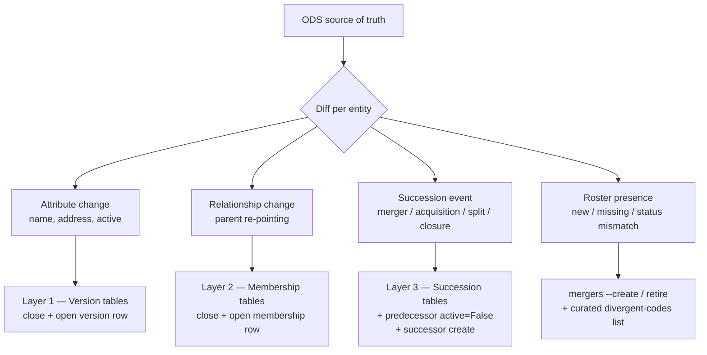

# ODS sync redesign — periodic structural reconciliation

> **Status:** Planning. This document is a design proposal, not a description
> of shipped behaviour. It supersedes the detection half of
> [`ods-change-detection.md`](ods-change-detection.md) once implemented.

## Why this plan exists

The current ODS sync (`cron --service organisations`, backed by
`general_functions/ods_update.py`) and the monthly change-detection job
(`ods_change_report`) were built to catch **attribute drift** (name, address,
contact details) on recently-changed entities. They do not reconcile the
**structure** of the organisational geography against ODS, and this has
produced real, visible gaps:

- **Trust acquisitions are not applied and often not even detected.** North
  Middlesex University Hospital NHS Trust (`RAP`) is now part of Royal Free
  London NHS Foundation Trust (`RAL`); Solent NHS Trust (`R1C`) is now part of
  Hampshire and Isle of Wight Healthcare NHS Foundation Trust (`RW1`). Neither
  appeared in the monthly detection issue (#172), and their child sites
  (e.g. North Middlesex `RAP01` → `RAL27`) still point at the old parents.
- **Children are never re-pointed.** The sync only ever writes attribute
  fields — it contains no relationship (`reassign_*`) writes at all — so a
  child moving to a new parent trust, ICB, or region is invisible to it.
- **New and retired codes are ignored.** The sync matches existing rows by ODS
  code; it never creates a new child code (e.g. `RAL27`) nor retires an old one
  (e.g. `RAP01`), and it never reads ODS `Status`, so it cannot deactivate a
  code ODS has closed.
- **The detection report is close to unreadable.** Issue #172 is ~350 lines of
  `target not in database, skipping` for pre-2016 legacy codes, with zero
  actionable items separated out. `ods_change_report` also runs only three of
  the five relevant checks — it omits `backfill_successions --entity
  organisation` and `backfill_trust_memberships`, which are exactly the checks
  that would surface child-level changes.
- **No roster or status reconciliation exists.** Nothing enumerates the full
  ODS roster per level and reports "in ODS, not in DB", "in DB, not in ODS", or
  "active in DB but Inactive in ODS" (the Wythenshawe `RM325` / `R0A07` class).
- **Tooling is inconsistent.** `backfill_successions` accepts `--report-file`;
  `backfill_trust_memberships` does not. `backfill.md` references a root script
  `ods_parallel_audit.py` that does not exist in the repository.

## Goal

A single, periodic, idempotent job that treats ODS as the source of truth and
reconciles the local database against it — detecting and (with review)
applying **mergers, acquisitions, splits, closures, renames, re-parentings,
and status changes** — while **freezing** every superseded name and
relationship into the temporal layer so that the as-of read path
(`GET /organisations/{ods_code}/snapshot/?date=…`) returns the geography that
was in force on any past date.

### In scope (levels)

All geography levels that ODS tracks:

| Level | Model | ODS role / source |
|---|---|---|
| Organisation (trust/LHB site) | `Organisation` | `RO198` (trust site), `RO144` (LHB site); parent via `RE6` |
| Trust | `Trust` | `RO197`; ICB via `RE5`/`RE8` → `RO261` |
| Local Health Board | `LocalHealthBoard` | `RO142` |
| Integrated Care Board | `IntegratedCareBoard` | `RO261` |
| NHS England Region | `NHSEnglandRegion` | derived — see open questions |
| Country | `Country` | derived — see open questions |

### Out of scope

- **Paediatric Diabetes Units** and **PDU networks** — not tracked by ODS;
  maintained from `Master_PDU_Lookup.xlsx` (see
  [`pdu-history.md`](pdu-history.md)).
- **OPEN UK (epilepsy) networks** — not an ODS concept.
- **Boundary geometry** — being deprecated in favour of the RCPCH Census
  Platform.

## What must be detected, per level

Each level has three independent timelines that can change. The job must
detect all three and route each to the correct temporal write.



| Change class | ODS signal | Temporal write | Helper |
|---|---|---|---|
| Attribute (name/address/active) | record field diff; `Status` flip | Layer 1 version row closed + opened at ODS effective date | `update_*_attributes` / `backfill_*_attributes` |
| Relationship (new parent) | `RE6` (org→trust), `RE5`/`RE8` (trust→ICB), region mapping | Layer 2 membership row closed + opened | `reassign_*` / `backfill_*_membership` |
| Succession (merger/acq/split/closure) | `Succs` block | Layer 3 succession row + predecessor `active=False` + successor baseline | admin / `mergers --create` + succession helpers |
| Code change on a surviving site | `Succs` on the org + new `RE6` | `OrganisationSuccession` + new `Organisation` + membership transfer | `mergers --create` + `OrganisationSuccession` |
| Roster presence / status | `?PrimaryRoleId=` list + `Status` | create, retire, or flag divergent | `mergers` + `ods_divergent_codes` |

## Detection mechanism

Three ODS data sources, used together:

1. **`/sync?LastChangeDate=`** — the cheap trigger feed. Lists codes changed in
   the last ≤185 days. Drives *which* entities to deep-fetch. Already wrapped by
   `fetch_updated_organisations`.
2. **`/organisations?PrimaryRoleId={role}&Limit=500`** — the full roster per
   level, with `Status` and `LastChangeDate`. Drives presence and status
   reconciliation. Partially wrapped (`all_nhs_hospitals_list` uses a different
   NHS API — needs a proper ODS-directory roster fetch).
3. **`/organisations/{ods_code}`** — per-entity detail (`Status`, `Rels`/`RE6`,
   `Succs`). Drives attribute, relationship, and succession diffs. Already
   wrapped by `get_organisation` / `fetch_organisation_by_ods_code`.

To keep volume manageable, deep-fetch (source 3) only entities flagged by the
`/sync` feed or by a roster diff, not every entity on every run. A full
deep-scan remains available as an explicit `--full` option (the current
`backfill_*` behaviour).

## Proposed command surface

Replace the overlapping `cron` / `backfill_successions` / `backfill_*_memberships`
/ `ods_change_report` surface with one orchestrator plus a shared engine:

```
python manage.py reconcile_ods \
    [--levels organisation,trust,lhb,icb,region] \
    [--window 185] \
    [--full] \
    [--dry-run]            # default; detection only, writes nothing
    [--apply]              # apply only the auto-safe class (see below)
    [--report-file PATH]   # clean markdown, standardised across the tool
```

- `--dry-run` (default) produces a **categorised** report: actionable items
  first, grouped by level and change class; legacy "predecessor not in DB"
  entries collapsed into a single count, not 350 lines.
- `--apply` applies only the **auto-safe** class (attribute changes with no
  succession, written at the ODS `LastChangeDate`). Everything structural is
  routed to the review queue.
- The existing `backfill_*` commands become thin wrappers (or are retired) once
  the engine covers their behaviour, so there is one code path, not five.

## Apply model — automatic vs reviewed

| Change class | Applied how |
|---|---|
| Attribute change, no succession in window | **Automatic** at ODS `LastChangeDate` (as today) |
| Succession (merger/acq/split/closure) | **Reviewed** — never automatic (ODS succession semantics are ambiguous) |
| Child re-pointing / new code / retire | **Reviewed** |
| Status flip contradicted by curated opinion (e.g. Wythenshawe) | **Reviewed** — may resolve to an `ods_divergent_codes` entry rather than a write |

Two options for the review surface:

1. **GitHub issue (current)** — cheap, but free text; a human must then drive
   the admin/wizard by hand. Keep as the notification channel.
2. **Pending-change review queue (recommended)** — persist each detected
   structural delta as a row in a new `PendingOdsChange` model (level, ods_code,
   change_class, old/new payload, ODS dates, succession events, status). Surface
   it in the admin with **Approve & apply** / **Dismiss** actions that call the
   existing temporal helpers and the merger wizard. This gives an auditable
   trail of *what ODS proposed*, *who approved it*, and *what was written* —
   and one-click application instead of retyping codes into the wizard.

## Preserving history (the freeze requirement)

This is the whole point. Every applied change must go through the temporal
helpers so the superseded state is frozen, never overwritten:

- **Rename / address / status change** → close the current `*Version` row at
  the ODS effective date and open a new one. The old name/address remains
  queryable as-of.
- **Parent change** → close the current `*Membership` row and open a new one.
  An as-of query before the change returns the old parent; after, the new one.
- **Merger / acquisition / split / closure** → write the `*Succession` row,
  flip the predecessor `active=False` via a version row, and create the
  successor with baseline version + membership rows. For a child whose ODS code
  changes, add an `OrganisationSuccession` so the audit chain walks
  predecessor → successor across the code boundary.

The read path already exists (`organisation_snapshot` / the snapshot endpoint);
the job's only job is to feed it correctly. No read-side changes are required.

## Phasing

**Phase 1 — Make detection trustworthy (reporting only).**
- Collapse legacy "predecessor not in DB" skips into a count; surface actionable
  successions separately.
- Add the two missing checks (organisation succession, trust membership) and all
  six levels to the combined report.
- Add roster + `active`-flag + parent-mismatch diffs.
- Standardise `--report-file` across every command.
- Fix the dangling `ods_parallel_audit.py` reference in `backfill.md`.
- Outcome: the monthly issue becomes a short, readable, complete worklist that
  would have flagged RAP, R1C, and their children.

**Phase 2 — Unify detection into one engine.**
- Build the `reconcile_ods` orchestrator over a shared per-level diff engine
  using the three ODS sources.
- Deep-fetch only `/sync`-flagged or roster-diffed entities; `--full` for a
  complete scan.

**Phase 3 — Review-and-apply workflow.**
- Add the `PendingOdsChange` model and admin review queue with
  **Approve & apply** wired to the temporal helpers and the merger wizard.
- Auto-apply the attribute-only class; route structural changes to the queue.

**Phase 4 — Schedule and harden.**
- Monthly `--dry-run` detection (existing Azure Container Apps Job), opening an
  issue and/or filling the review queue.
- Idempotency and safety checks so re-runs never double-write.

## Open questions

- **NHS England Region and Country have no clean ODS role.** Regions sit above
  ICBs; their membership currently follows the trust→ICB→region chain. Country
  is effectively static. Decide whether to detect region changes indirectly
  (via ICB→region remapping during the 2026 ICB reorganisation) or treat them
  as curated. Country is almost certainly curated-only.
- **Parallel active codes (Wythenshawe).** When ODS keeps two active codes for
  one physical site, detection should raise a *review* item, not an automatic
  write — the resolution is a curated `ods_divergent_codes` decision or a
  deliberate `OrganisationSuccession`, not something the job can infer.
- **Wizard integration point.** The apply step must call the same helpers the
  existing merger wizard uses, so there is one write path. Confirm the wizard's
  entry points and whether it can be driven from a `PendingOdsChange` row.
- **The predecessor-not-in-DB problem.** Issue #172 shows most ODS successions
  target legacy codes never seeded. Decide the policy: seed historic trust codes
  as inactive stubs so successions can be recorded end-to-end, or accept that
  pre-DB-era successions are out of scope and collapse them in reporting.
- **Volume and rate limits.** A full per-level deep scan is hundreds to
  thousands of `/organisations/{ods_code}` calls. Confirm ODS rate tolerance and
  whether roster `LastChangeDate` is sufficient to avoid deep-fetching unchanged
  entities.

## Relationship to existing docs

- [`temporal-history.md`](temporal-history.md) — the schema (Layers 1–3) this
  job writes into. Unchanged by this plan.
- [`merger-handling.md`](merger-handling.md) — the manual/wizard workflow this
  job's apply step automates.
- [`backfill.md`](backfill.md) — the one-off historical recovery commands this
  plan unifies into `reconcile_ods`.
- [`ods-change-detection.md`](ods-change-detection.md) — the scheduling/CI
  wrapper, retained; its detection payload is replaced by Phase 1–2.
- [`ods-api.md`](ods-api.md) — the ODS endpoint, role, `Rels`, and `Succs`
  reference underpinning the detection mechanism.
