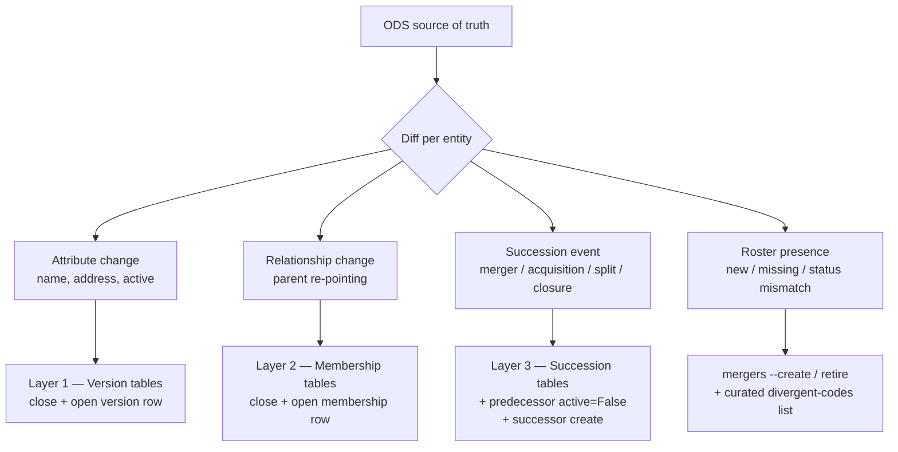

# ODS sync redesign — periodic structural reconciliation

> **Status:** Planning. This document is a design proposal, not a description
> of shipped behaviour. It supersedes the detection half of
> [`ods-change-detection.md`](ods-change-detection.md) once implemented.

## Why this plan exists

The current ODS sync (`cron --service organisations`, backed by
`general_functions/ods_update.py`) and the monthly change-detection job
(`ods_change_report`) were built to catch **attribute drift** (name, address,
contact details) on recently-changed entities. They do not reconcile the
**structure** of the organisational geography against ODS, and this has
produced real, visible gaps:

- **Trust acquisitions are not applied and often not even detected.** North
  Middlesex University Hospital NHS Trust (`RAP`) is now part of Royal Free
  London NHS Foundation Trust (`RAL`); Solent NHS Trust (`R1C`) is now part of
  Hampshire and Isle of Wight Healthcare NHS Foundation Trust (`RW1`). Neither
  appeared in the monthly detection issue (#172), and their child sites
  (e.g. North Middlesex `RAP01` → `RAL27`) still point at the old parents.
- **Children are never re-pointed.** The sync only ever writes attribute
  fields — it contains no relationship (`reassign_*`) writes at all — so a
  child moving to a new parent trust or ICB is invisible to it.
- **New and retired codes are ignored.** The sync matches existing rows by ODS
  code; it never creates a new child code (e.g. `RAL27`) nor retires an old one
  (e.g. `RAP01`), and it never reads ODS `Status`, so it cannot deactivate a
  code ODS has closed.
- **The detection report is close to unreadable.** Issue #172 is ~350 lines of
  `target not in database, skipping` for pre-2016 legacy codes, with zero
  actionable items separated out. `ods_change_report` also runs only three of
  the five relevant checks — it omits `backfill_successions --entity
  organisation` and `backfill_trust_memberships`, which are exactly the checks
  that would surface child-level changes.
- **No roster or status reconciliation exists.** Nothing enumerates the full
  ODS roster per level and reports "in ODS, not in DB", "in DB, not in ODS", or
  "active in DB but Inactive in ODS" (the Wythenshawe `RM325` / `R0A07` class).
- **Tooling is inconsistent.** `backfill_successions` accepts `--report-file`;
  `backfill_trust_memberships` does not. `backfill.md` references a root script
  `ods_parallel_audit.py` that does not exist in the repository.

## Goal

A single, periodic, idempotent job that treats ODS as the source of truth and
reconciles the local database against it — detecting and (with review)
applying **mergers, acquisitions, splits, closures, renames, re-parentings,
and status changes** — while **freezing** every superseded name and
relationship into the temporal layer so that the as-of read path
(`GET /organisations/{ods_code}/snapshot/?date=…`) returns the geography that
was in force on any past date.

### In scope (levels)

The four geography levels this job reconciles against ODS:

| Level | Model | ODS role / source | Roster policy |
|---|---|---|---|
| Organisation (trust/LHB site) | `Organisation` | `RO198` (trust site), `RO144` (LHB site); parent via `RE6` | **Closed set** — see below |
| Trust | `Trust` | `RO197`; ICB via `RE5`/`RE8` → `RO261` | Full roster — hold all |
| Local Health Board | `LocalHealthBoard` | `RO142` | Full roster — hold all |
| Integrated Care Board | `IntegratedCareBoard` | `RO261` | Full roster — hold all |

### Out of scope

- **NHS England Regions** and **Countries** — rarely change and have no clean
  ODS role; maintained **by hand in the admin** when needed, not by this job.
- **Paediatric Diabetes Units** and **PDU networks** — not tracked by ODS;
  maintained from `Master_PDU_Lookup.xlsx` (see
  [`pdu-history.md`](pdu-history.md)).
- **OPEN UK (epilepsy) networks** — not an ODS concept.
- **Boundary geometry** — being deprecated in favour of the RCPCH Census
  Platform.

### The organisation set is closed

This is a load-bearing constraint. The database holds **every** trust, LHB,
and ICB in the UK, but only a **subset** of organisations (sites) — those the
audits actually report against. The job must preserve that subset and must not
bloat the database with sites we do not need.

Therefore the roster policy differs by level:

- **Trusts / LHBs / ICBs — full reconciliation.** Detect entities in ODS but
  not in the DB and create them; detect retired entities and close them. We
  want the complete set at these levels.
- **Organisations — closed set, succession-follow only.** Do **not** import the
  full `RO198`/`RO144` roster. Only act on organisations we already hold:
    - If a held organisation's ODS code has been **superseded** (its `Succs`
      block names a successor, or its `RE6` parent changed and ODS issued a new
      code), fetch the successor organisation, create it, link it via
      `OrganisationSuccession`, and mark the old one `active=False`.
    - Do **not** create organisations that are new in ODS but unrelated to any
      organisation we already hold.

In short: at the organisation level the job follows succession chains outward
from the codes we care about, and stops there.

### Temporal floor: 1 December 2020, and the backward predecessor walk

The historical layer has a hard floor of **1 December 2020**. Nothing earlier
is reconstructed.

- **Pre-2020 codes are ignored.** A trust/LHB/ICB/organisation whose ODS code
  was already **inactive before 1 December 2020** is out of scope entirely — no
  row, no stub, no succession. (This resolves the issue #172 noise: the ~350
  legacy `predecessor not in DB` lines are all pre-2020 and are simply dropped.)
  Only entities **active on 1 December 2020 or later** are included.
- **Held entities are reconstructed backward to the floor.** For every entity
  we currently hold, walk its ODS `Succs`/`Rels` history **backward** and bake
  in every code/name/parent it had **on or after 1 December 2020**. If an
  organisation we hold today existed under a *different code or name* in
  December 2020, that predecessor code/name/parent must appear in the historical
  layer so that `GET /organisations/{ods_code}/snapshot/?date=2020-12-01` finds
  it **and its parents**.

Worked example (the North Middlesex case):

- We hold `RAL27` (North Middlesex, under Royal Free `RAL`) today.
- In December 2020 the same site was `RAP01` under North Middlesex Trust `RAP`.
- The backfill must create the `RAP01` organisation row (active in that
  interval), its `OrganisationTrustMembership` → `RAP`, an `OrganisationSuccession`
  `RAP01` → `RAL27`, and the `RAP` trust row + its memberships — all because
  `RAP` was active on 1 December 2020. An as-of query for 2020-12-01 then
  returns `RAP01` under `RAP`; for today, `RAL27` under `RAL`.

So the organisation-level reconstruction is **bidirectional but bounded**:
forward to pick up current successors of held codes, backward to pick up
predecessor codes/names/parents that were live on or after the floor. The walk
stops as soon as it crosses 1 December 2020.

## What must be detected, per level

Each level has three independent timelines that can change. The job must
detect all three and route each to the correct temporal write.



| Change class | ODS signal | Temporal write | Helper |
|---|---|---|---|
| Attribute (name/address/active) | record field diff; `Status` flip | Layer 1 version row closed + opened at ODS effective date | `update_*_attributes` / `backfill_*_attributes` |
| Relationship (new parent) | `RE6` (org→trust), `RE5`/`RE8` (trust→ICB) | Layer 2 membership row closed + opened | `reassign_*` / `backfill_*_membership` |
| Succession (merger/acq/split/closure) | `Succs` block | Layer 3 succession row + predecessor `active=False` + successor baseline | admin / `mergers --create` + succession helpers |
| Superseded organisation code | `Succs` on the held org + new `RE6` | `OrganisationSuccession` + new `Organisation` + membership transfer | `mergers --create` + `OrganisationSuccession` |
| Roster presence / status (**trust/LHB/ICB only**) | `?PrimaryRoleId=` list + `Status` | create, retire, or flag divergent | `mergers` + `ods_divergent_codes` |

## Detection mechanism

Three ODS data sources, used together:

1. **`/sync?LastChangeDate=`** — the cheap trigger feed. Lists codes changed
   since a date (≤185 days). Drives *which* entities to deep-fetch on an
   ongoing run. Already wrapped by `fetch_updated_organisations`.
2. **`/organisations?PrimaryRoleId={role}&Limit=500`** — the roster per level,
   with `Status` and `LastChangeDate`. Used for **trust / LHB / ICB** presence
   and status reconciliation only (the organisation level is a closed set and
   is *not* roster-reconciled — see above). `all_nhs_hospitals_list` uses a
   different NHS API, so a proper ODS-directory roster fetch is needed.
3. **`/organisations/{ods_code}`** — per-entity detail (`Status`, `Rels`/`RE6`,
   `Succs`). Drives attribute, relationship, and succession diffs, and is how
   superseded organisation codes are followed to their successors. Already
   wrapped by `get_organisation` / `fetch_organisation_by_ods_code`.

### Rate limiting

The ODS API tolerates at most **5000 requests per 5 minutes** (~16.6 req/s).
The engine must throttle to stay safely under this (e.g. a token-bucket limiter
at ~10 req/s). One deep-fetch returns an entity's *entire* history, so each
entity needs only **one** `/organisations/{ods_code}` call per run. Rough
volumes: ~215 trusts + ~7 LHBs + 42 ICBs + the held organisation subset
(low thousands) — a full one-off deep-scan is a few thousand calls, completing
in a handful of minutes within the limit. Ongoing runs deep-fetch only the
handful of entities flagged by `/sync` or a roster diff.

## One-off history bake vs ongoing increment

History only needs to be **baked in once**. The two modes are distinct:

- **One-off historical backfill (run once).** Deep-fetch every held entity and
  reconstruct its full timeline from the ODS `Succs`/`Rels` history back to
  **1 December 2020** (the earliest date audit reporting needs). This freezes
  all names, relationships, and successions since that date into Layers 1–3.
  Run once, reviewed, applied.
- **Ongoing incremental sync (monthly).** Once history is baked, each run only
  needs to catch what changed **since the last successful run** — a short
  `/sync` window (e.g. 30–40 days with margin), **not** 185 days every time.
  The 185-day limit only ever mattered as a one-off recovery ceiling; after the
  bake, a monthly cadence with a ~35-day window never approaches it.

The engine records the last successful run date so the ongoing window is
self-adjusting. A `--since` override covers missed runs.

## Proposed command surface

Replace the overlapping `cron` / `backfill_successions` / `backfill_*_memberships`
/ `ods_change_report` surface with one orchestrator plus a shared engine:

```
python manage.py reconcile_ods \
    [--levels organisation,trust,lhb,icb] \
    [--mode incremental|backfill] \   # incremental = since last run; backfill = full history
    [--since YYYY-MM-DD] \            # override; one-off bake uses 2020-12-01
    [--dry-run]            # default; detection only, writes nothing
    [--apply]             # apply only the auto-safe class (see below)
    [--report-file PATH]  # clean markdown, standardised across the tool
```

- `--mode backfill --since 2020-12-01` is the one-off history bake.
- `--mode incremental` (the monthly default) uses the stored last-run date.
- `--dry-run` (default) produces a **categorised** report: actionable items
  first, grouped by level and change class; legacy "predecessor not in DB"
  entries collapsed into a single count, not 350 lines.
- `--apply` applies only the **auto-safe** class (attribute changes with no
  succession, written at the ODS `LastChangeDate`) and writes every structural
  delta to the `PendingOdsChange` queue.
- The existing `backfill_*` commands become thin wrappers (or are retired) once
  the engine covers their behaviour, so there is one code path, not five.

## Apply model — automatic vs reviewed

| Change class | Applied how |
|---|---|
| Attribute change, no succession in window | **Automatic** at ODS `LastChangeDate` (as today) |
| Succession (merger/acq/split/closure) | **Reviewed** — never automatic (ODS succession semantics are ambiguous) |
| Child re-pointing / superseded code / retire | **Reviewed** |
| New trust / LHB / ICB in ODS (roster add) | **Reviewed** |
| Parallel active codes (e.g. Wythenshawe `RM325`/`R0A07`) | **Reviewed** — few in number; a human decides whether to override ODS via an `ods_divergent_codes` entry or a deliberate `OrganisationSuccession` |

Structural changes are **never** applied automatically; they land in the
`PendingOdsChange` queue for human review.

### PendingOdsChange model (confirmed)

Persist each detected structural delta as a `PendingOdsChange` row:

- `level` (organisation / trust / lhb / icb), `ods_code`
- `change_class` (attribute / relationship / succession / roster-add / retire /
  parallel-code)
- `payload` (old → new values, succession events, ODS legal/operational dates,
  successor code where applicable)
- `detected_at`, `status` (pending / approved / applied / dismissed),
  `reviewed_by`, `applied_at`

The admin surfaces the queue with **Approve & apply** / **Dismiss** actions.
**Approve & apply drives the existing merger-wizard functions and temporal
helpers** — it does not reimplement the writes. This is the single apply path:
detection fills the queue, the wizard (invoked from the queue row) performs the
Layer 1–3 writes. The row then records what was written, by whom, and when.

### Raising the monthly GitHub issue

Detection runs **against the live Azure database**, from the Azure Container
Apps Job, because the DB is only reachable from inside that environment. Keep
the existing (deliberately complex) issue-posting path intact: the job writes
the combined report to Azure Blob Storage between the sentinel markers, the
GitHub workflow downloads the blob and opens an issue if it is non-empty (see
[`ods-change-detection.md`](ods-change-detection.md)). That path does not
change — the job simply (a) populates `PendingOdsChange` rows in the live DB
**and** (b) emits the same blob report, so every monthly run both fills the
review queue and raises the notification issue.

## Preserving history (the freeze requirement)

This is the whole point. Every applied change must go through the temporal
helpers so the superseded state is frozen, never overwritten:

- **Rename / address / status change** → close the current `*Version` row at
  the ODS effective date and open a new one. The old name/address remains
  queryable as-of.
- **Parent change** → close the current `*Membership` row and open a new one.
  An as-of query before the change returns the old parent; after, the new one.
- **Merger / acquisition / split / closure** → write the `*Succession` row,
  flip the predecessor `active=False` via a version row, and create the
  successor with baseline version + membership rows. For a child whose ODS code
  changes, add an `OrganisationSuccession` so the audit chain walks
  predecessor → successor across the code boundary.

The read path already exists (`organisation_snapshot` / the snapshot endpoint);
the job's only job is to feed it correctly. No read-side changes are required.

## Phasing

**Phase 1 — Make detection trustworthy (reporting only).**
- Collapse legacy "predecessor not in DB" skips into a count; surface actionable
  successions separately.
- Add the two missing checks (organisation succession, trust membership) and the
  four in-scope levels to the combined report.
- Add trust/LHB/ICB roster + `active`-flag + parent-mismatch diffs (organisation
  level is closed-set, so succession-follow only — no roster import).
- Standardise `--report-file` across every command (note:
  `backfill_trust_memberships` currently lacks it).
- Fix the dangling `ods_parallel_audit.py` reference in `backfill.md`.
- Outcome: the monthly issue becomes a short, readable, complete worklist that
  would have flagged RAP, R1C, and their children.

**Phase 2 — Unify detection into one engine.**
- Build the `reconcile_ods` orchestrator over a shared per-level diff engine
  using the three ODS sources, with the token-bucket rate limiter.
- Store the last successful run date for the self-adjusting incremental window.

**Phase 3 — One-off history bake.**
- Run `reconcile_ods --mode backfill --since 2020-12-01 --dry-run`, review, then
  apply. This freezes all names/relationships/successions since 2020-12-01.
- After this, ongoing runs use `--mode incremental` with a ~35-day window.

**Phase 4 — Review-and-apply workflow.**
- Add the `PendingOdsChange` model and admin review queue with **Approve &
  apply** wired to the **existing merger-wizard functions** and temporal helpers.
- Auto-apply the attribute-only class; route structural changes to the queue.

**Phase 5 — Schedule and harden.**
- Monthly incremental `--dry-run` detection from the existing Azure Container
  Apps Job, which both fills `PendingOdsChange` in the live DB and emits the
  blob report that raises the GitHub issue.
- Idempotency and safety checks so re-runs never double-write.

## Open questions

- **Parallel active codes (Wythenshawe).** When ODS keeps two active codes for
  one physical site, detection raises a *review* item, not an automatic write.
  Expected to be few; the resolution is a curated `ods_divergent_codes` decision
  or a deliberate `OrganisationSuccession`, decided by a human. This is the one
  remaining judgement call left to the reviewer, not the engine.

## Resolved decisions

- **NHS England Regions and Countries are out of scope** — updated by hand in
  the admin when needed.
- **`PendingOdsChange` queue is adopted**, and the monthly GitHub issue is
  retained alongside it via the existing Azure blob → workflow path.
- **Apply integrates with the existing wizard**, driven from `PendingOdsChange`
  rows — one write path.
- **History is baked once** back to **2020-12-01**; ongoing runs use a short
  incremental window, not 185 days.
- **Rate limit is 5000 requests / 5 minutes** — the engine throttles below it.
- **Temporal floor is 1 December 2020.** Entities inactive before that date are
  ignored entirely (no stubs). Only entities active on or after 2020-12-01 are
  included. This drops the issue #172 legacy noise by construction.
- **Held entities are reconstructed backward to the floor.** Any organisation
  held today that existed under a different code/name on/after 2020-12-01 has
  that predecessor code/name/parent baked into the historical layer, so an
  as-of query finds it and its parents.

## Implementation surface (for the build session)

Everything a separate implementation session needs to touch, so nothing is
missed. Treat this as the definition of done.

### Models and migrations

- **`PendingOdsChange` model** (new) — fields as listed above (`level`,
  `ods_code`, `change_class`, `payload` JSON, `detected_at`, `status`,
  `reviewed_by`, `applied_at`, plus a free-text `reviewer_notes` and a
  `source_run` stamp). Add the migration.
- **Last-run marker** — a small singleton/model (or a `PendingOdsChange`-adjacent
  `OdsSyncRun` row) recording the last successful incremental run date, so the
  window self-adjusts. Add the migration.
- **No changes to the Layer 1–3 schema** — the temporal tables are reused as-is.
  Confirm `OrganisationSuccession`, `TrustSuccession`, and the membership tables
  cover every write the engine makes; if the ICB/LHB succession path needs a
  table that does not yet exist, flag it before building.
- Reuse `ods_divergent_codes` for the parallel-active-code overrides; no schema
  change, but the reconciler must *read* `diverged_from_ods` so it does not
  re-flag curated divergences every run.

### Engine and commands

- New `reconcile_ods` management command (orchestrator) with the shared
  per-level diff engine, token-bucket rate limiter (≤ ~10 req/s), and the
  `--mode`, `--since`, `--dry-run`, `--apply`, `--report-file`, `--levels` args.
- Proper ODS-directory roster fetch (`?PrimaryRoleId=RO197/RO142/RO261`) —
  `all_nhs_hospitals_list` uses a different NHS API and cannot be reused.
- Reuse `get_organisation`, `_extract_succession_info`,
  `_extract_trust_membership_info`, `_parse_ods_date` from `ods_update.py`;
  extend extraction to `Status` (active flag) and to the backward predecessor
  walk bounded at 2020-12-01.
- Retire or thin-wrap `cron`, `backfill_successions`, `backfill_trust_memberships`,
  `backfill_icb_memberships`, and `ods_change_report` so there is one code path.
  Keep backwards-compatible entry points if the Azure job or CI call them by
  name until the workflow is updated.
- Standardise `--report-file` everywhere (note `backfill_trust_memberships`
  currently lacks it — the gap that triggered this plan).

### Admin changes

- `PendingOdsChange` admin: list view grouped by level/change_class, filters on
  `status`, read-only payload rendering (old → new, succession events, dates).
- **Approve & apply** action — calls the existing merger-wizard functions /
  temporal helpers in one transaction, then stamps `status=applied`,
  `applied_at`, `reviewed_by`. Must be idempotent (re-approve is a no-op).
- **Dismiss** action — stamps `status=dismissed` with a required reason.
- For parallel-active-code rows, offer a shortcut that writes an
  `ods_divergent_codes` entry instead of a temporal change.
- Confirm the existing "Reassign to a new trust", "Rename…", "Deactivate…", and
  succession admin pages are reachable from the apply path (they are the wizard
  functions being driven).

### Tests (mirror the existing offline-mock strategy)

All ODS network calls are mocked (see `testing.md`); no live calls. Add:

- `test_reconcile_ods.py` — engine unit tests per change class (attribute,
  relationship, succession, superseded-org, roster add/retire, parallel-code),
  each asserting the correct Layer 1–3 writes and the `PendingOdsChange` row.
- **Temporal floor tests** — an entity inactive before 2020-12-01 is ignored; an
  entity active on/after it is included; the backward predecessor walk stops at
  the floor.
- **Backward-reconstruction test** — the North Middlesex worked example:
  `RAL27` held today → `RAP01`/`RAP` reconstructed for 2020-12-01; assert the
  snapshot endpoint returns the right parent for 2020-12-01 and for today.
- **Closed-set test** — a new unrelated ODS site is *not* imported; a superseded
  held org *is* followed to its successor.
- **Rate-limiter test** — throttle stays under 5000/5min (mock the clock).
- **Incremental-window test** — the stored last-run date drives the next window;
  `--since` overrides it.
- **Idempotency test** — a second identical run writes nothing new and creates no
  duplicate `PendingOdsChange` rows.
- `test_admin.py` additions — Approve & apply performs the writes and is
  idempotent; Dismiss requires a reason; the divergent-code shortcut works.
- Update `test_ods_change_report.py` (or replace with `test_reconcile_ods`
  report tests) for the categorised report and collapsed legacy-skip count.

### Documentation updates

- **This doc** → flip `Status: Planning` to shipped and move the design into the
  present tense once built.
- **`ods-change-detection.md`** → update the "three checks" section to the new
  engine, the categorised report, and the `PendingOdsChange` queue; keep the
  Azure blob → issue mechanism description.
- **`merger-handling.md`** → add the "driven from the review queue" path to
  "User steps for implementing mergers"; note the wizard is now also callable
  from `PendingOdsChange`.
- **`backfill.md`** → mark the old `backfill_*` commands as superseded by
  `reconcile_ods`; **fix the dangling `ods_parallel_audit.py` reference**.
- **`testing.md`** → add the new test files to the coverage table.
- **`AGENTS.md`** → update the management-commands and tests tables.
- **`models.md`** → document `PendingOdsChange` (and the run-marker model).

### CI / scheduling

- Point the Azure Container Apps Job at `reconcile_ods --mode incremental
  --dry-run` instead of `ods_change_report`; keep the blob upload + GitHub issue
  workflow unchanged.
- Ensure the one-off `--mode backfill --since 2020-12-01` run is a documented
  manual step (not scheduled), reviewed before `--apply`.

## Relationship to existing docs

- [`temporal-history.md`](temporal-history.md) — the schema (Layers 1–3) this
  job writes into. Unchanged by this plan.
- [`merger-handling.md`](merger-handling.md) — the manual/wizard workflow this
  job's apply step automates.
- [`backfill.md`](backfill.md) — the one-off historical recovery commands this
  plan unifies into `reconcile_ods`.
- [`ods-change-detection.md`](ods-change-detection.md) — the scheduling/CI
  wrapper, retained; its detection payload is replaced by Phase 1–2.
- [`ods-api.md`](ods-api.md) — the ODS endpoint, role, `Rels`, and `Succs`
  reference underpinning the detection mechanism.
