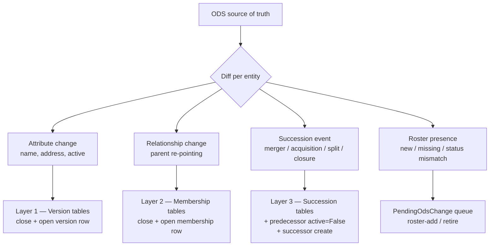

# ODS sync — periodic structural reconciliation

`reconcile_ods` is the single engine that keeps the local organisational
geography in step with NHS ODS. It treats ODS as the source of truth and
reconciles the database against it across four geography levels — detecting
**mergers, acquisitions, splits, closures, renames, re-parentings, and status
changes** — while **freezing** every superseded name and relationship into the
temporal layer so the as-of read path
(`GET /organisations/{ods_code}/snapshot/?date=…`) returns the geography that
was in force on any past date.

It replaces the overlapping detection surface of the old `cron`,
`backfill_successions`, `backfill_trust_memberships`, `backfill_icb_memberships`,
and `ods_change_report` commands with one code path. Those commands remain as
backward-compatible entry points, but new work should use `reconcile_ods`.

This document is the operational reference: what the command does, how it
writes, and **how often to run it**. For the temporal schema it writes into,
see [`temporal-history.md`](temporal-history.md); for the ODS endpoints it
reads, see [`ods-api.md`](ods-api.md); for the monthly Azure job and GitHub
issue, see [`ods-change-detection.md`](ods-change-detection.md).

## The four levels and the roster policy

| Level | Model | ODS role / source | Roster policy |
|---|---|---|---|
| Organisation (trust/LHB site) | `Organisation` | `RO198` (trust site), `RO144` (LHB site); parent via `RE6` | **Closed set** — succession-follow only |
| Trust | `Trust` | `RO197`; ICB via `RE5`/`RE8` → `RO261` | Full roster — hold all |
| Local Health Board | `LocalHealthBoard` | `RO142` | Full roster — hold all |
| Integrated Care Board | `IntegratedCareBoard` | `RO261` | Full roster — hold all |

The roster policy differs by level because **the organisation set is closed**.
The database holds *every* trust, LHB, and ICB in the UK, but only the
**subset** of organisations (sites) that the audits report against.

- **Trusts / LHBs / ICBs — full reconciliation.** Entities present in ODS but
  not in the DB are detected as roster adds; retired entities are detected for
  closure. The complete set is held at these levels.
- **Organisations — closed set, succession-follow only.** The full
  `RO198`/`RO144` roster is **not** imported. The engine only acts on
  organisations already held: if a held organisation's code has been superseded
  (its `Succs` block names a successor, or its `RE6` parent changed and ODS
  issued a new code), the successor is followed, created, and linked via
  `OrganisationSuccession`, and the old code is deactivated. Organisations that
  are new in ODS but unrelated to any held code are never created.

### Out of scope

- **NHS England Regions** and **Countries** — maintained by hand in the admin.
- **Paediatric Diabetes Units** and **PDU networks** — not tracked by ODS;
  maintained from `Master_PDU_Lookup.xlsx` (see [`pdu-history.md`](pdu-history.md)).
- **OPEN UK (epilepsy) networks** — not an ODS concept.
- **Boundary geometry** — being deprecated in favour of the RCPCH Census Platform.

## The temporal floor: 1 December 2020

The historical layer has a hard floor of **1 December 2020**
(`TEMPORAL_FLOOR`). Nothing earlier is reconstructed.

- **Pre-2020 codes are ignored.** Any entity whose ODS code was already
  inactive before the floor is out of scope entirely — no row, no stub, no
  succession. Succession references that point at a predecessor/target which
  does not exist in the database before the floor are collapsed into a single
  `legacy_skips` count rather than being reported line by line (this is what
  eliminated the ~350 lines of pre-2016 noise in older detection issues).
- **Held entities are reconstructed backward to the floor.** For every held
  entity, the backfill mode walks its ODS `Succs`/`Rels` history backward and
  bakes in every code/name/parent it had on or after 1 December 2020, then
  stops. The walk is bidirectional but bounded: forward to pick up current
  successors of held codes, backward to pick up predecessor codes/names/parents
  that were live on or after the floor.

**Worked example — North Middlesex.** The database holds `RAL27` (North
Middlesex, under Royal Free `RAL`) today. In December 2020 the same site was
`RAP01` under North Middlesex University Hospital NHS Trust `RAP`. The backfill
reconstructs the `RAP01` organisation row, its `OrganisationTrustMembership` →
`RAP`, an `OrganisationSuccession` `RAP01` → `RAL27`, and the `RAP` trust row
and its memberships (because `RAP` was active on the floor). An as-of query for
`2020-12-01` then returns `RAP01` under `RAP`; for today it returns `RAL27`
under `RAL`.

## What is detected, per level

Each entity has three independent timelines that can change — attributes,
relationships, and succession — plus roster presence for the full-roster
levels. The engine detects all of them and routes each to the correct temporal
write.



| Change class | ODS signal | Temporal write | Helper |
|---|---|---|---|
| `attribute` (name/address/active) | field diff; `Status` flip | Layer 1 version row closed + opened at the ODS effective date | `update_*_attributes` / `backfill_*_attributes` |
| `relationship` (new parent) | `RE6` (org→trust), `RE5`/`RE8` (trust→ICB) | Layer 2 membership row closed + opened | `reassign_*` / `backfill_*_membership` |
| `succession` (merger/acq/split/closure) | `Succs` block | Layer 3 succession row + predecessor `active=False` + successor baseline | succession helpers via the apply path |
| `superseded-code` | `Succs` on the held org + new `RE6` | `OrganisationSuccession` + new `Organisation` + membership transfer | succession helpers via the apply path |
| `roster-add` (**trust/LHB/ICB only**) | `?PrimaryRoleId=` list | create entity | roster helpers via the apply path |
| `retire` (**trust/LHB/ICB only**) | `Status` = Inactive | deactivate entity | `deactivate_*` via the apply path |
| `parallel-code` | two active codes for one site | review only | human decision (see below) |

### Detection sources

Three ODS data sources are used together (see
[`ods-api.md`](ods-api.md) and `general_functions/reconcile/ods_sources.py`):

1. **`/sync?LastChangeDate=`** — the cheap trigger feed. Lists codes changed
   since a date (≤185 days). Drives *which* entities to deep-fetch on an
   incremental run.
2. **`/organisations?PrimaryRoleId={role}&Limit=500`** — the roster per level,
   with `Status` and `LastChangeDate`. Used for trust / LHB / ICB presence and
   status reconciliation (organisations are a closed set and are not
   roster-reconciled).
3. **`/organisations/{ods_code}`** — per-entity detail (`Status`, `Rels`/`RE6`,
   `Succs`). One deep-fetch returns an entity's entire history, so each entity
   needs only one such call per run. Drives attribute, relationship, and
   succession diffs, and is how superseded organisation codes are followed to
   their successors.

### Rate limiting

ODS tolerates at most **5000 requests per 5 minutes** (~16.6 req/s). The engine
throttles below this with a token-bucket limiter
(`general_functions/reconcile/rate_limit.py`), defaulting to **10 req/s**
(`--rate`). A full backfill deep-scan is a few thousand calls (~215 trusts, ~7
LHBs, 42 ICBs, plus the held organisation subset) and completes in a few
minutes; incremental runs deep-fetch only the handful of entities flagged by
`/sync` or a roster diff.

## The `reconcile_ods` command

```
python manage.py reconcile_ods \
    [--levels organisation,trust,lhb,icb] \
    [--mode incremental|backfill] \
    [--since YYYY-MM-DD] \
    [--dry-run]            # default; detection only, writes nothing
    [--apply]             # auto-apply attribute-only changes; queue the rest
    [--queue]             # with --dry-run: fill the review queue, no temporal writes
    [--report-file PATH] \
    [--check-overlaps] \
    [--rate N] \
    [--upload-blob]
```

| Flag | Default | Meaning |
|---|---|---|
| `--levels` | all four | Comma-separated subset of `organisation,trust,lhb,icb`. |
| `--mode` | `incremental` | `incremental` = changes since the last successful run; `backfill` = deep-fetch every held entity and reconstruct history back to the floor. |
| `--since YYYY-MM-DD` | — | Override the window start. In incremental mode this is the `/sync` window start; in backfill mode it is the temporal floor (the one-off bake uses `2020-12-01`). |
| `--dry-run` | on (implied) | Detection and report only; **writes nothing**. The default when neither `--apply` nor `--dry-run` is given. |
| `--apply` | off | Auto-apply attribute-only changes to the temporal layer **and** queue structural changes. Mutually exclusive with `--dry-run`. |
| `--queue` | off | With `--dry-run`, still write structural deltas to `PendingOdsChange` (but no temporal rows). This is what the monthly Azure job uses. |
| `--report-file PATH` | stdout | Write the categorised markdown report to a file instead of stdout. |
| `--check-overlaps` | off | After reconciling, assert no entity has two open version rows and no overlapping intervals; exit non-zero on any violation. |
| `--rate N` | `10` | ODS request throttle in requests/second. |
| `--upload-blob` | off | Print the report between the `<<<ODS_REPORT_START>>>` / `<<<ODS_REPORT_END>>>` sentinel markers and upload it to Azure Blob Storage. Used by the monthly job; requires the storage env vars (see [`ods-change-detection.md`](ods-change-detection.md)). |

### Write semantics

This is the critical distinction. `--apply` and `--dry-run` are mutually
exclusive, and the default is dry-run.

| Invocation | Temporal layer | `PendingOdsChange` queue | Typical use |
|---|---|---|---|
| `--dry-run` (or no flag) | nothing written | nothing written | **Local verification** — compare detection against ODS by eye. |
| `--dry-run --queue` | nothing written | structural deltas queued | **Monthly Azure job** — fills the review queue and raises the issue. |
| `--apply` | attribute-only changes applied | structural deltas queued | Apply the auto-safe class; route everything structural to review. |

Structural changes (succession, superseded-code, relationship, roster-add,
retire, parallel-code) are **never** applied automatically — they always land
in the `PendingOdsChange` queue for human review. Only the **attribute-only**
class is auto-safe, and only when there is no succession in the window; it is
written at the ODS effective date.

### The categorised report

The report (`general_functions/reconcile/report.py`) groups actionable items
by level and change class, newest and most structural first. Pre-floor legacy
succession references are collapsed into a single count, and un-fetchable
entities are listed as a footnote. **An empty actionable report renders as an
empty string**, which is how the blob → GitHub-issue path knows there is
nothing to report.

## How often to run each mode

### Backfill — one-off, manual

`reconcile_ods --mode backfill --since 2020-12-01` is the **one-off history
bake**. It deep-fetches every held entity and reconstructs the full timeline of
names, relationships, and successions back to the temporal floor. History only
needs to be baked once. The workflow is:

1. `reconcile_ods --mode backfill --since 2020-12-01 --dry-run` — review the
   report.
2. `reconcile_ods --mode backfill --since 2020-12-01 --dry-run --queue` —
   populate the `PendingOdsChange` queue.
3. Review and **Approve & apply** from the admin (see below).
4. `reconcile_ods --check-overlaps` — confirm the bake added no overlaps.

This is a documented manual step, not scheduled.

### Incremental — monthly

`reconcile_ods --mode incremental` is the ongoing cadence, run **monthly** by
the Azure Container Apps Job as
`reconcile_ods --mode incremental --dry-run --queue --upload-blob` (see
[`ods-change-detection.md`](ods-change-detection.md)). Each run only catches
what changed since the last successful run.

The window is **self-adjusting**. `_resolve_window` reads
`OdsSyncRun.last_successful(mode="incremental").synced_through` and scans from
`synced_through − MARGIN_DAYS` (5 days of overlap to catch anything that landed
around the previous boundary). If there is no prior successful run, it falls
back to `DEFAULT_INCREMENTAL_WINDOW_DAYS` (35 days). A `--since` override
bypasses this and covers missed runs. Because the bake has already frozen
history, the monthly window never approaches the 185-day `/sync` ceiling.

## The review queue and admin

Detection fills the **`PendingOdsChange`** queue; a human reviews and applies.
Each detected structural delta is one upserted row, unique on
`(level, ods_code, change_class, effective_date)` so a monthly re-run never
re-queues an already-pending or already-applied change. Statuses are
`pending` → `approved`/`applied` or `dismissed`.

In the Django admin, `PendingOdsChangeAdmin` (grouped by level/change class,
filterable by status) offers two actions:

- **Approve & apply selected changes** — drives
  `general_functions/reconcile/apply.py::apply_pending_change`, which calls the
  **existing** idempotent temporal helpers (`update_*` / `reassign_*` /
  `deactivate_*` / `backfill_*` / succession helpers) in one transaction, then
  stamps `status=applied`, `applied_at`, and `reviewed_by`. Re-approving an
  already-applied row is a no-op. The engine never calls `Model.objects.create`
  on a temporal table directly — there is one apply path.
- **Dismiss selected changes** — requires a free-text reason, then stamps
  `status=dismissed` with the reason and reviewer.

Every run is recorded as an **`OdsSyncRun`** row (mode, levels, since,
`synced_through`, dry-run flag, `changes_detected`, status, and the stored
report). `OdsSyncRun.last_successful(mode=…)` — the most recent non-dry-run
success — drives the self-adjusting incremental window. `OdsSyncRunAdmin` is
read-only.

For the merger-specific view of this workflow, see
[`merger-handling.md`](merger-handling.md).

## Idempotency and overlap safety

Production already contains rows written by the old `backfill_*` commands, so
the engine must treat those as authoritative and never duplicate them. Two
properties guarantee this:

- **Every Layer 1–3 write goes through the existing idempotent helpers** and
  derives interval endpoints identically to them (same `_parse_ods_date`
  source — Operational.Start falling back to Legal.Start — and the same
  half-open `[valid_from, valid_to)` convention). A second run over the same
  ODS record updates the matching row in place via `update_or_create`, or skips
  it on an `exists()` check, rather than inserting an overlapping duplicate. A
  re-run over already-backfilled data therefore adds **zero** temporal rows and
  **zero** new queue rows.
- **`--check-overlaps`** asserts that no entity has two open (`valid_to IS
  NULL`) version rows and that no two intervals overlap for the same entity. Run
  it before and after the one-off bake to prove the bake introduced no
  overlaps.

## The snapshot read path

The read side is unchanged by `reconcile_ods`. Because every applied change is
frozen into the temporal layer, `GET /organisations/{ods_code}/snapshot/?date=…`
assembles the entity version plus every relationship as of the requested date.
This is the mechanism behind the North Middlesex example above, and the primary
way to verify a run locally: compare the snapshot at a historical date and at
today against ODS.

## Related docs

- [`temporal-history.md`](temporal-history.md) — the Layer 1–3 schema this
  engine writes into.
- [`merger-handling.md`](merger-handling.md) — the merger workflow the review
  queue drives.
- [`backfill.md`](backfill.md) — the legacy one-off recovery commands this
  engine unifies.
- [`ods-change-detection.md`](ods-change-detection.md) — the monthly Azure job
  and GitHub-issue reporting wrapper.
- [`ods-api.md`](ods-api.md) — the ODS endpoints, roles, `Rels`, and `Succs`
  reference underpinning detection.
- [`models.md`](models.md) — the `OdsSyncRun` and `PendingOdsChange` models.
